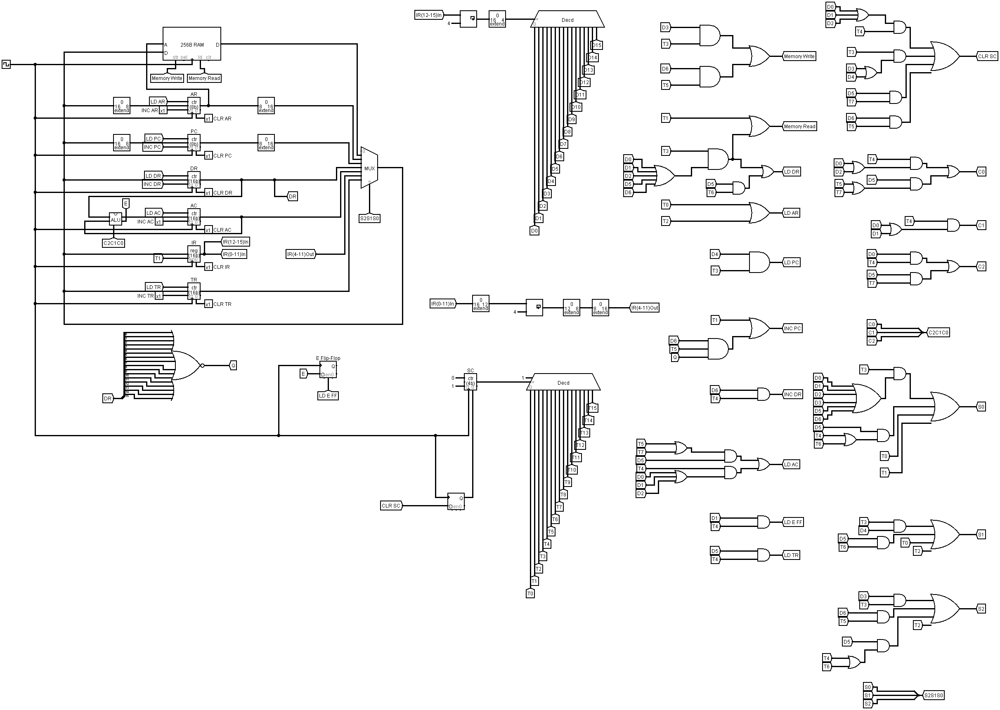
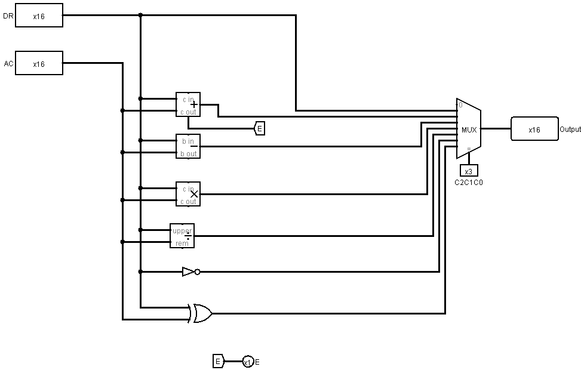

# Mano Basic Computer

A Logisim implementation of a **Mano-inspired 16-bit basic computer**, developed as Team 130 coursework at the German University in Cairo in Spring 2026.

A shared bus connects memory and registers; an ALU transforms data; a hardwired control unit turns instruction opcodes and timing steps into register transfers.

**[Project walkthrough →](https://doma990.github.io/projects/mano-basic-computer/)** · **[Download the project →](https://github.com/doma990/mano-basic-computer/archive/refs/heads/main.zip)**



## Two design milestones

1. **Datapath:** connect RAM, AR, PC, DR, AC, IR, TR, and the ALU through a common 16-bit bus selected by `S2 S1 S0`.
2. **Control:** decode the instruction and sequence counter, then generate memory, register, bus, and ALU control signals for the required loop program.

This is a course-specific adaptation of the Basic Computer associated with **M. Morris Mano's Computer System Architecture**. It implements the required direct-address instruction subset, with the assignment's instruction encoding and XOR/DIV extensions. It does not implement the complete textbook instruction set, indirect addressing, interrupts, or a halt mechanism.

## Open and run

Use **classic Logisim 2.7.1**, the version recorded in the original circuit. The file uses built-in libraries only. Get Logisim from its [official website](https://www.cburch.com/logisim/). The Java `.jar` version can be used on Windows, macOS, or Linux with a compatible Java runtime; the original Windows launcher is another option.

1. Download and extract this repository. In Logisim, choose **File → Open** and select [`circuit/Mano-Basic-Computer.circ`](circuit/Mano-Basic-Computer.circ).
2. Open the **main** circuit. Keep **Simulate → Ticks Enabled** off while setting up. Choose **Simulate → Reset Simulation** to start with cleared register state.
3. Right-click the RAM and choose **Load Image…**, then select [`examples/loop-program.txt`](examples/loop-program.txt). RAM contents are separate from the `.circ` file; reload them after reopening or resetting.
4. Use **Simulate → Tick Once** to advance the clock, or enable ticks at a low frequency. Two ticks normally make one full clock cycle. Watch PC, IR, SC, DR, and AC as fetch, decode, and execution progress.
5. Inspect RAM addresses `10`, `11`, `12`, and `13` (hex) for A, B, C, and the loop counter. Stop ticking when the final iteration finishes: this submission has no automatic halt. Disable ticks before inspecting the result.

The circuit was opened and both subcircuits exported successfully in Logisim 2.7.1 for this documentation. The complete program has not been independently validated here; the results below are the milestone's expected results.

## Datapath

| Component | Role |
| --- | --- |
| RAM | 256 words × 16 bits, separate read/write control |
| AR, PC | 8-bit address register and program counter |
| DR, AC, TR | 16-bit data, accumulator, and temporary registers |
| IR | 16-bit instruction register |
| SC | 4-bit sequence counter decoded into timing signals |
| E | Carry storage for addition |

The address registers are extended to 16 bits when driving the bus and narrowed when loaded from it.

| Bus select | Source | ALU select | Operation (A = DR, B = AC) |
| --- | --- | --- | --- |
| `001` | RAM | `001` | Transfer A |
| `010` | AR | `010` | A + B |
| `011` | PC | `011` | A − B |
| `100` | DR | `100` | A × B |
| `101` | AC | `101` | A / B |
| `110` | IR | `110` | Complement A |
| `111` | TR | `111` | A XOR B |



The ALU contains more operations than the seven instructions used by the automatic control unit. Multiplication, subtraction, and complement are datapath capabilities, not additional implemented program instructions.

## Fetch, decode, execute

Each instruction uses a 4-bit opcode in IR bits **12–15** and an 8-bit direct address in bits **4–11**. Bits 0–3 are unused.

```text
T0: AR ← PC
T1: IR ← M[AR], PC ← PC + 1
T2: Decode IR[12:15], AR ← IR[4:11]
T3 onward: execute the selected instruction
```

| Opcode | Instruction | Effect |
| --- | --- | --- |
| `0` | XOR | AC ← AC XOR M[address] |
| `1` | ADD | AC ← AC + M[address], capture carry in E |
| `2` | LDA | AC ← M[address] |
| `3` | STA | M[address] ← AC |
| `4` | BUN | PC ← address |
| `5` | DIV | AC ← AC / M[address] |
| `6` | ISZ | Increment M[address]; skip the next instruction if zero |

Opcode and timing decoders feed AND/OR networks for load, increment, memory read/write, sequence-counter clear, and the two multiplexers. A flip-flop sits on the sequence-counter clear path to handle Logisim's asynchronous counter clear.

### Why division needs TR

The ALU divides DR by AC, while the instruction needs the old AC divided by the memory operand. The team's report specifies these extra transfers:

```text
T3: DR ← M[AR]
T4: TR ← AC
T5: AC ← DR
T6: DR ← TR
T7: AC ← DR / AC, SC ← 0
```

TR preserves the numerator while DR and AC exchange roles. See the [technical control report](docs/control-report.txt) for the original instruction timings and Boolean control equations.

## Example program

The provided memory image starts with A = 15, B = 5, C = 0, and a loop counter of −3. It repeats:

```text
A ← A + (A XOR B)
C ← C + integer_divide(A, B)
```

| After iteration | A (decimal) | C (decimal) |
| --- | ---: | ---: |
| 1 | 25 | 5 |
| 2 | 53 | 15 |
| 3 | 101 | 35 |

These are expected arithmetic results from the assignment. The final RAM words should be **A = `0065`** at `10`, **C = `0023`** at `12`, and **counter = `0000`** at `13` (all hex). ISZ skips BUN after the third iteration. The supplied image has zeros after the loop and no HLT instruction; continuing to tick executes those words, so stop manually at completion.

## Credits

**Architecture:** M. Morris Mano, *Computer System Architecture*, Basic Computer organization and design.

**Course:** CSEN/CSIS 402, German University in Cairo, Spring 2026; Dr. Milad Ghantous and Dr. Shereen Afifi.

**Implementation:** Team 130, including Adam Ibrahim.

[Logisim documentation: memory images](https://www.cburch.com/logisim/docs/2.7/en/html/guide/mem/menu.html) · [Simulation controls](https://www.cburch.com/logisim/docs/2.7/en/html/guide/menu/simulate.html).
